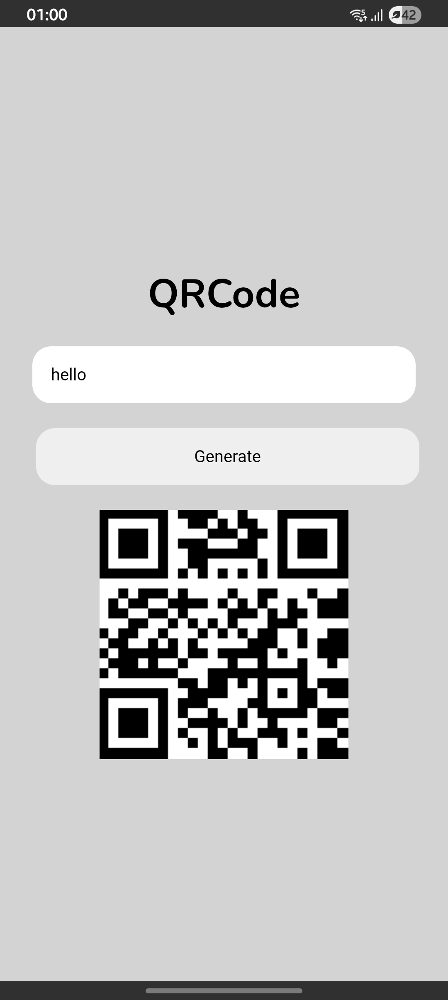
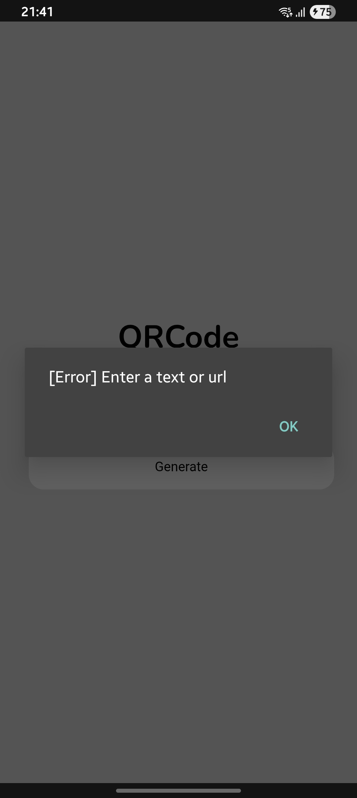

## QR Code Generator

**Version:** 1.0

I developed a simple **QR code generator** focused on delivering a lightweight, functional, and user-friendly experience.

- **No ads** — a clean, uninterrupted experience.
- **No data collection** — user privacy comes first.
- **Lightweight** — designed to be fast and efficient.
- **Simple and functional** — focused on doing exactly what users need, without unnecessary complexity.

### Requirements

- **Operating System:** Android 7.0 (Nougat) or later.
- **Minimum SDK:** API Level 24.
- **Target SDK:** API Level 36.

> This is the initial release (v1.0), with room for future improvements and new features.

## Download

[**Download QR Code Generator v1.0 (APK)**](downloads/GenerateQRCode.apk)